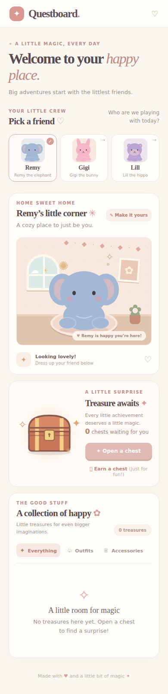

# Questboard: Creature Companions

A cozy, mobile-first creature companion game for Remy, Gigi, and Lill. Collect
treasures, dress your creature, and decorate its nursery. Each profile has its
own saved creature, chests, and collection.



## Play

Choose a profile, name and customize its creature, then use the simulated reward
button to earn a chest. Open it for a collectible and use your collection to
equip clothes and accessories or place toys, furniture, and decorations. In
Play mode, creatures wander occasionally; tap the floor to guide them and tap
your creature for a happy reaction. Switch to Decorate mode to pause wandering
and edit the nursery. Select an object to show its resize, layering, and reset
controls; drag or pinch objects to arrange them. Layouts are saved separately
for each friend. Rewards are selected from items the player does not already
own; when the collection is complete, no chest is consumed attempting to open it.

This first version uses **simulated rewards only**. It does not read or modify
Home Assistant entities, chores, automations, or reminders. Medication tasks
must never be used for rewards. The backend has a boundary for a future,
read-only reward source; live synchronization is not enabled.

## Install on Home Assistant Green

Do not install or deploy until you are ready to try the game:

1. In Home Assistant, open **Settings → Apps → App Store** (on older versions,
   **Settings → Add-ons → Add-on Store**).
2. Open the menu, choose **Repositories**, and add
   `https://github.com/agkhayyam01/questboard-home-assistant`.
3. Find **Questboard Creature Companions**, install it, and start it. The first
   installation builds the image and may take a while.
4. Open Questboard from the sidebar or the app's **Open Web UI** button.

The app supports ARM64 (`aarch64`, including Home Assistant Green) and AMD64.
Home Assistant ingress provides authentication; the game does not expose a
separate network port. Profiles are not separate security accounts: anyone
allowed to open the app can use all profiles. The SQLite database is stored in
the app's persistent `/data` directory and is included in Home Assistant app
backups. Back up the app before removing it or migrating installations.

## Local development and testing

Prerequisites: Python 3.12, Node.js 22, and npm.

```sh
cd questboard
python -m venv .venv
. .venv/bin/activate
pip install -r backend/requirements.txt
pip install -r backend/requirements-test.txt
cd frontend
npm ci
npm run build
cd ..
DATA_DIR="$(pwd)/.local-data" uvicorn backend.main:app --reload
```

Open `http://127.0.0.1:8000/`. The backend serves the built frontend. Rebuild
the frontend after changes. To run the backend tests:

```sh
cd questboard
python -m pytest backend
```

Run frontend tests and the production build with:

```sh
cd questboard/frontend
npm ci
npm test
npm run build
```

Pull requests run the backend and frontend tests and production build in GitHub
Actions. CI also validates the Home Assistant app configuration, then builds
and checks the image on a native ARM64 runner. The container test simulates
ingress and verifies that a Docker volume retains SQLite data after recreation;
it does not install or deploy the app to Home Assistant.

To run the container integration test locally:

```sh
docker build -t questboard-ci ./questboard
cd questboard
QUESTBOARD_TEST_IMAGE=questboard-ci python -m pytest backend/tests/test_addon_container.py
```

No Home Assistant credentials or tokens are needed.
