# Questboard: Creature Companions

A cozy, mobile-first creature companion game for Remy, Gigi, and Lill. Collect
treasures, dress your creature, decorate its nursery, and share treats. Each
profile has its own saved creature, affection, treat inventory, chests, and
collection.


Lill's mobile nursery before and after the 0.3 hippo redesign:
[before (0.2.0)](screenshots/lill-before.png) ·
[after (0.3.0)](screenshots/lill-after.png).

## 0.3.1 animation checks

Captured nursery scenes from the running app:

| Scene | Screenshot |
|---|---|
| Remy, elephant | 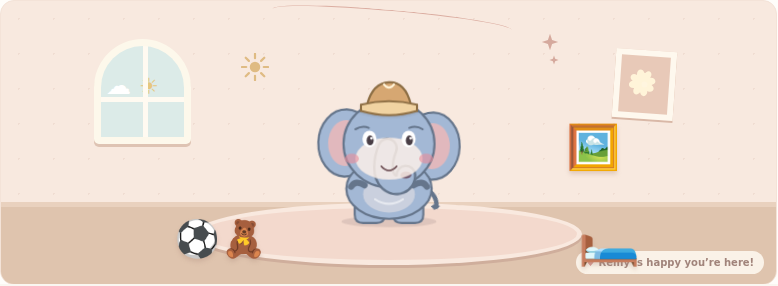 |
| Gigi, bunny | 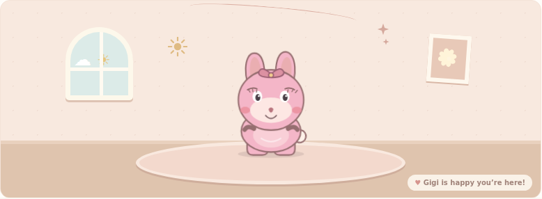 |
| Lill, hippo | 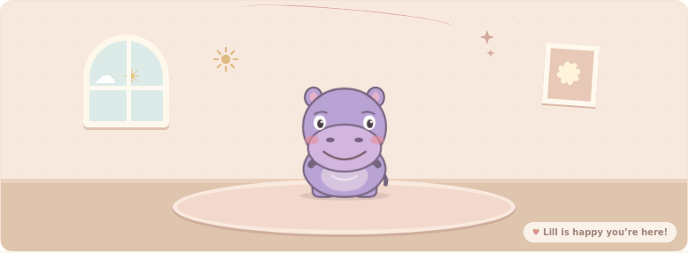 |
| Feeding | 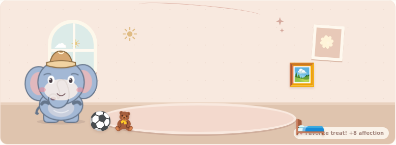 |
| Painting admiration | 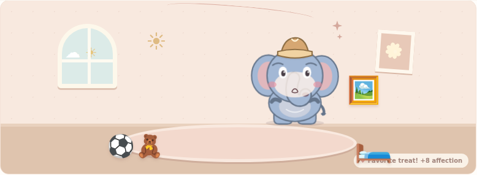 |
| Ball play | 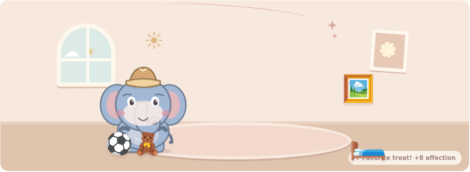 |
| Bedtime | 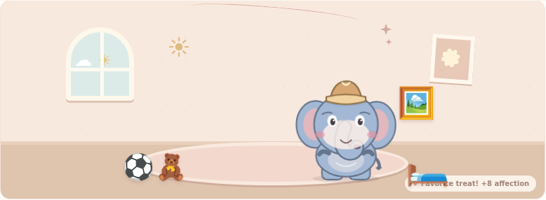 |
| Stuffed-animal hug | 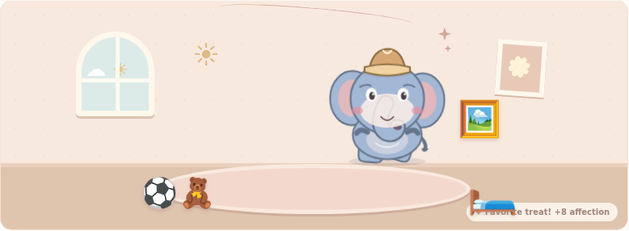 |

## 0.4.0 release notes and visual verification

Questboard 0.4.0 reduces the displayed character size while preserving the
grounded pose, gives Remy an opaque outlined trunk, and enlarges new default
beds without changing saved layouts. Player-directed object interactions now
coordinate approach, anticipation, interaction, reaction, and recovery;
creatures climb into bed to sleep, roll and chase the ball, carry and hug the
stuffed animal, and look up at paintings. Petting has a visible affection
response, feeding is staged from anticipation through swallowing, and
autonomous object visits avoid recent repeats. Existing profiles, inventory,
treats, affection, and saved layouts are preserved; no database migration was
required.

The following are screenshots of the rendered 0.4.0 app running locally with
disposable test data. They are visual evidence, not animation-state-only test
results; no Home Assistant instance was used.

| Check | Screenshot |
|---|---|
| Remy, Gigi, and Lill scaled and grounded | 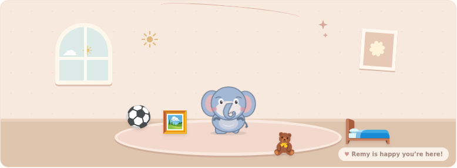 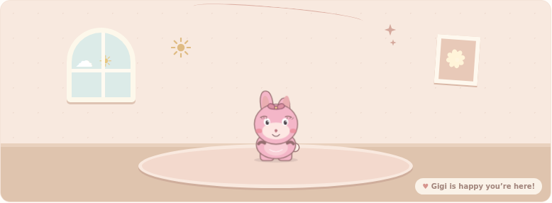 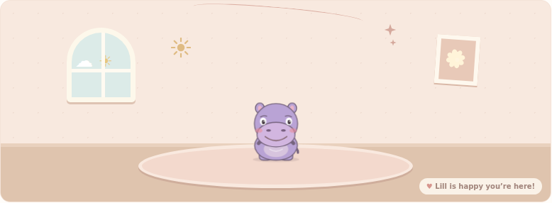 |
| Opaque trunk and petting response | 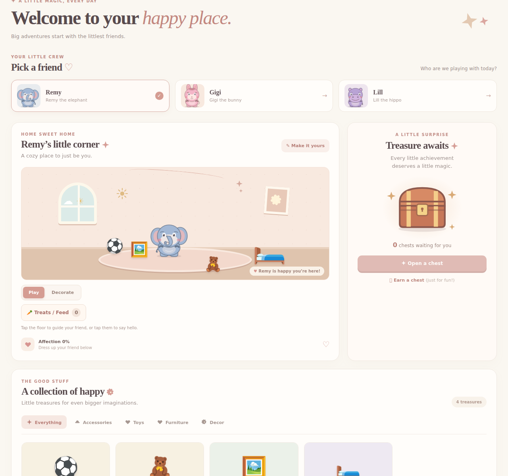 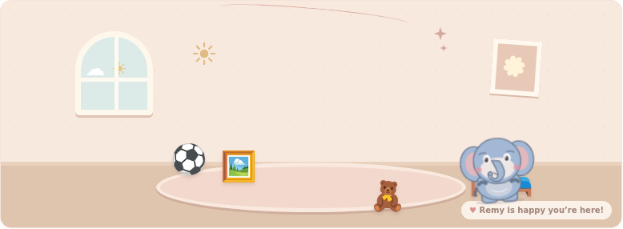 |
| Larger bed and in-bed sleep pose | 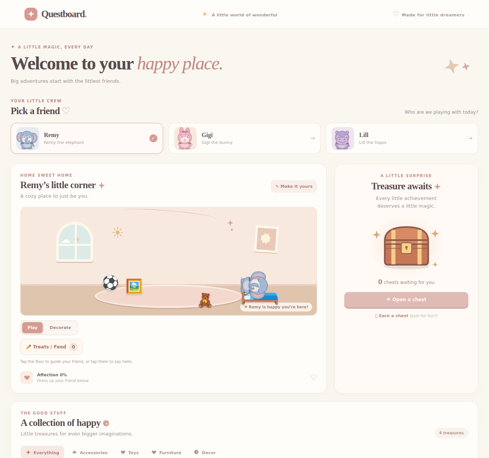 |
| Ball rolls during play | 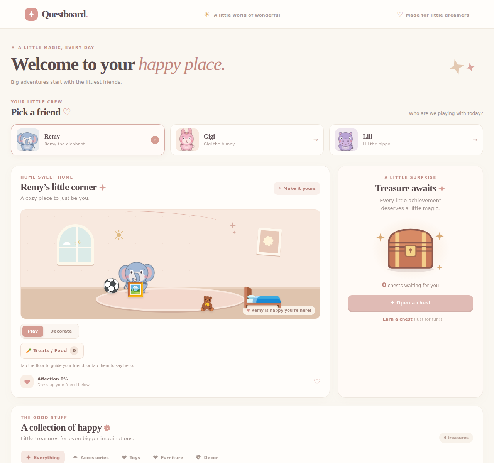 |
| Stuffed animal is picked up and hugged | 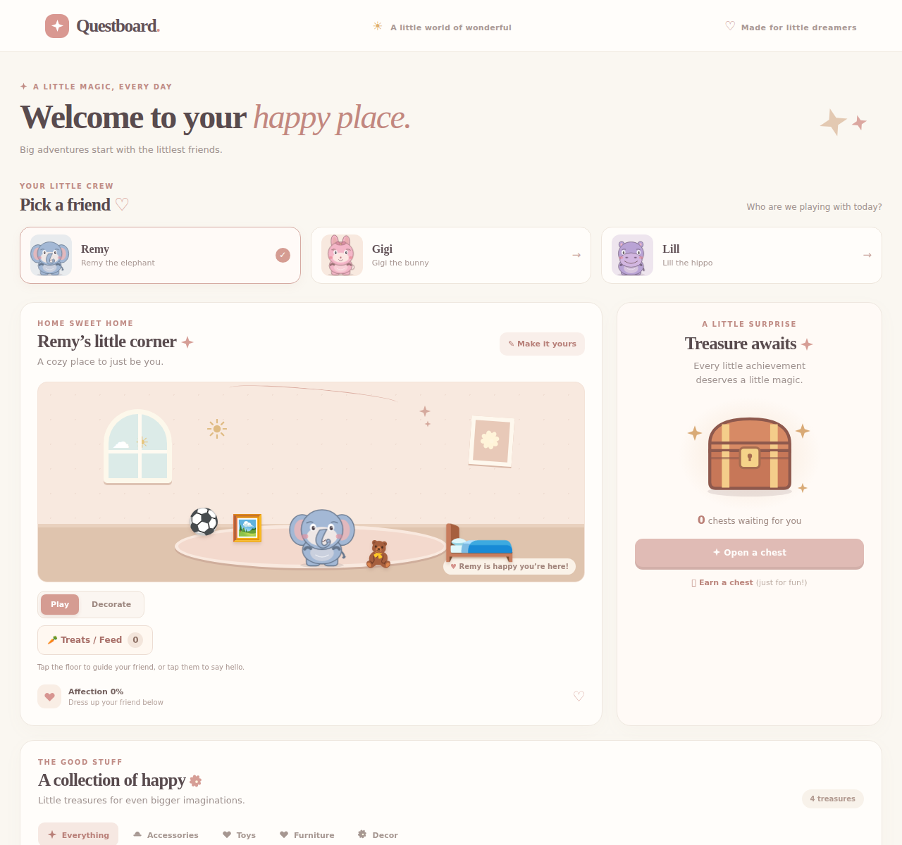 |
| Painting admiration |  |
| Complete feeding sequence | [5-second rendered recording](screenshots/questboard-040-feeding-sequence.webm) · 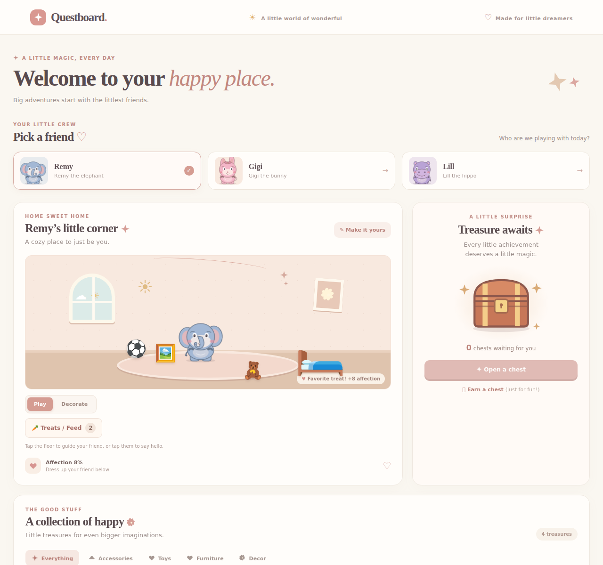 |
| Autonomous object interaction | 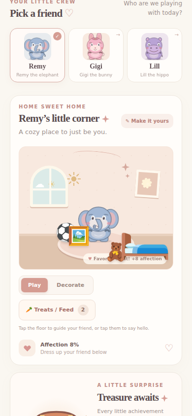 |
| iPhone-sized nursery layout (390px viewport) | 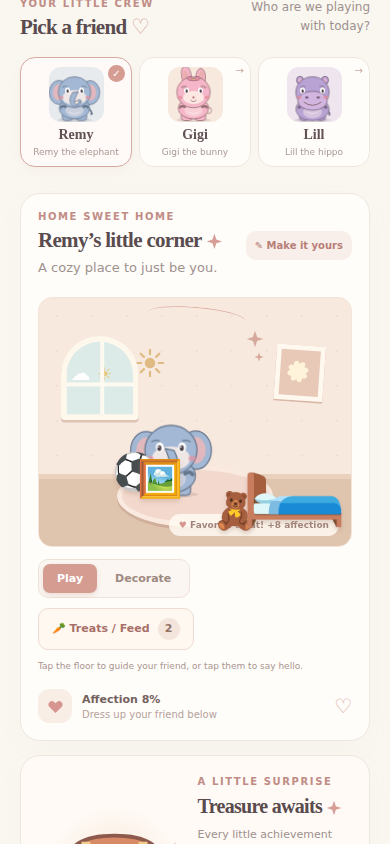 |

### Visual acceptance follow-up

Fresh close-ups and a live ball-play recording from the rendered app after the
visual review corrections. The sleep screenshot was captured only while the
browser confirmed `data-action="sleeping"` and `data-pose="reclined"` with a
pillow and quilt rendered. The hug screenshot was captured only while
`data-action="hugging"` with the floor toy hidden and the teddy drawn between
Remy’s arms. The 5.1-second browser recording shows the ball approach, roll and
rotation, Remy’s chase, and recovery. These checks used disposable local data;
the profile, inventory, and saved layouts were unchanged. The accepted 390px
phone capture remains unchanged; compact defaults are presentation-only and
saved layouts continue to take precedence.

| Review item | Updated rendered evidence |
|---|---|
| Remy reclined in bed with a pillow and quilt | 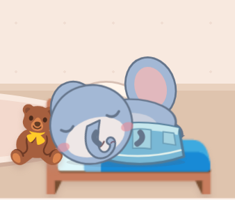 |
| Teddy visibly held between Remy’s wrapping arms | 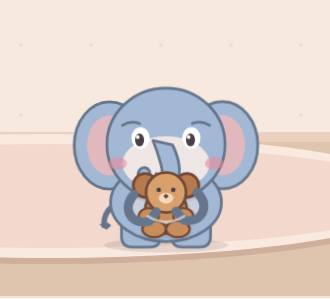 |
| Ball approach, roll, chase, and recovery | [5.1-second live browser recording](screenshots/questboard-042-ball-play.webm) |
| Separated default objects and character on an iPhone-sized screen | 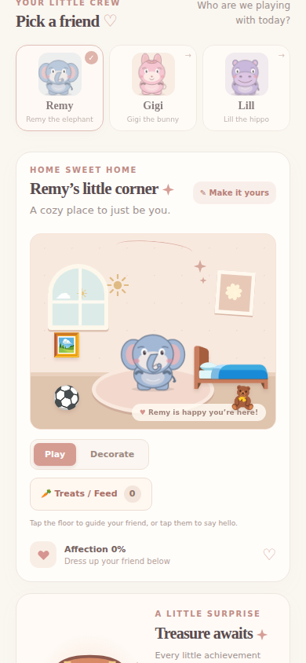 |

## Play

Choose a profile, name and customize its creature, then use the simulated reward
button to earn a chest. Open it for a collectible and use your collection to
equip accessories or place toys, furniture, and decorations. Unsupported
full-body outfits are temporarily hidden from selection; saved collection data
is preserved. In Play mode, creatures wander around the floor; tap the floor to
guide them, or tap a painting, ball, bed, or stuffed animal for a coordinated
interaction. Other nursery items remain decorations. Decorate mode pauses
wandering and lets children select, drag, pinch, and arrange objects.

Open **Treats / Feed** to claim three free treats per profile each local day and
feed the creature. Daily treats match each species' favorite. Treat quantities
and affection are saved independently for each profile; unused treats remain
available, and missed days do not cause penalties. A rare moonberry can be
added through the pretend milestone control. Set `household_timezone` in the
Questboard app configuration to an IANA timezone such as `America/Los_Angeles`
to choose the daily reset boundary. The default is `UTC`.

Rewards are selected from items the player does not already own; when the
collection is complete, no chest is consumed attempting to open it.

Questboard uses **simulated rewards only**. It does not read or modify
Home Assistant entities, chores, automations, or reminders. Medication tasks
must never be used for rewards. The backend has a boundary for a future,
read-only reward source; live synchronization is not enabled.

GitHub Actions runs tests and builds on pull requests. Repository administrators
can enable **Settings → General → Pull Requests → Allow auto-merge** and configure
required checks in branch protection to allow successful pull requests to merge
automatically. The repository's current CI workflow only has read permissions;
no workflow bypasses review rules or failed checks.

## Install on Home Assistant Green

Do not install or deploy until you are ready to try the game:

### 0.4.0 deployment checklist (not performed)

- [ ] Create and verify a Questboard-only backup of its persistent data.
- [ ] Review the release notes, screenshots, and any remaining limitations.
- [ ] Obtain separate, explicit user approval before installation.
- [ ] Confirm the backup can be restored and the target supports ARM64.
- [ ] Only after approval, install and verify ingress and data persistence.

No Home Assistant deployment or installation was performed for this release.

1. In Home Assistant, open **Settings → Apps → App Store** (on older versions,
   **Settings → Add-ons → Add-on Store**).
2. Open the menu, choose **Repositories**, and add
   `https://github.com/agkhayyam01/questboard-home-assistant`.
3. Find **Questboard Creature Companions**, install it, and start it. The first
   installation builds the image and may take a while.
4. Open Questboard from the sidebar or the app's **Open Web UI** button.

The app supports ARM64 (`aarch64`, including Home Assistant Green) and AMD64.
Home Assistant ingress provides authentication; the game does not expose a
separate network port. Profiles are not separate security accounts: anyone
allowed to open the app can use all profiles. The SQLite database is stored in
the app's persistent `/data` directory and is included in Home Assistant app
backups. Back up the app before removing it or migrating installations.

## Local development and testing

Prerequisites: Python 3.12, Node.js 22, and npm.

```sh
cd questboard
python -m venv .venv
. .venv/bin/activate
pip install -r backend/requirements.txt
pip install -r backend/requirements-test.txt
cd frontend
npm ci
npm run build
cd ..
DATA_DIR="$(pwd)/.local-data" uvicorn backend.main:app --reload
```

Open `http://127.0.0.1:8000/`. The backend serves the built frontend. Rebuild
the frontend after changes. To run the backend tests:

```sh
cd questboard
python -m pytest backend
```

Run frontend tests and the production build with:

```sh
cd questboard/frontend
npm ci
npm test
npm run build
```

Pull requests run the backend and frontend tests and production build in GitHub
Actions. CI also validates the Home Assistant app configuration, then builds
and checks the image on a native ARM64 runner. The container test simulates
ingress and verifies that a Docker volume retains SQLite data after recreation;
it does not install or deploy the app to Home Assistant.

To run the container integration test locally:

```sh
docker build -t questboard-ci ./questboard
cd questboard
QUESTBOARD_TEST_IMAGE=questboard-ci python -m pytest backend/tests/test_addon_container.py
```

No Home Assistant credentials or tokens are needed.
